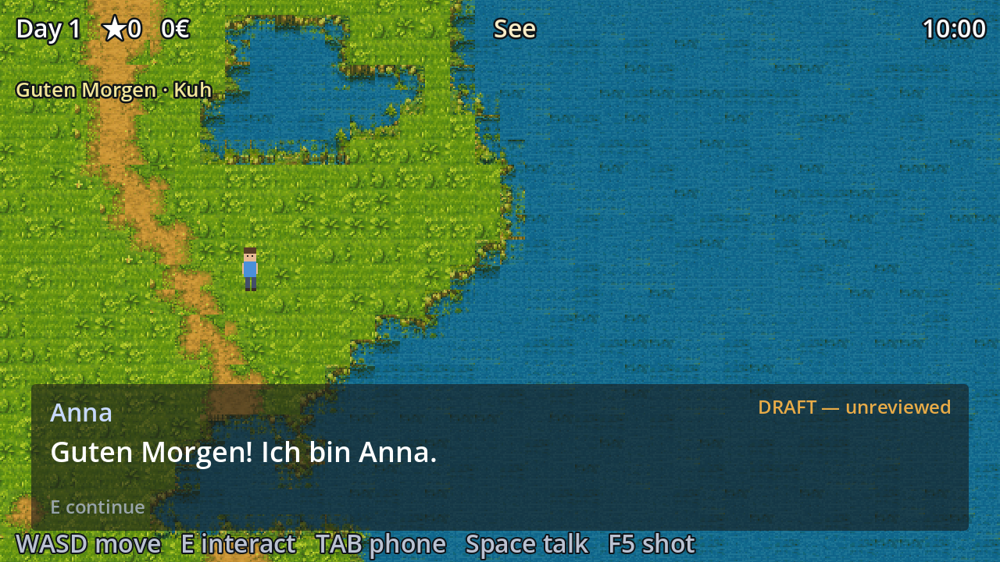
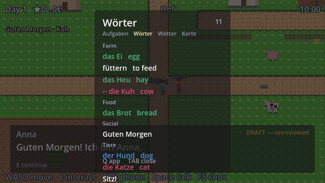
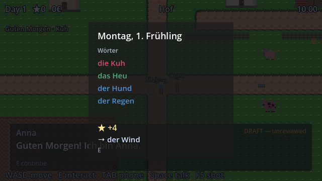
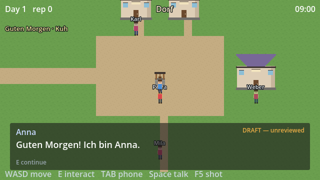

# Langame

A cozy farming RPG where you learn German by speaking it.

You move to a small German village, work a farm, and get to know sixteen villagers. They talk to you only in German, and you answer out loud. As you learn, your character's own inner thoughts, the only English in the game, turn into German one word at a time.

Built in Godot with GDScript. Solo project, built with an AI agent workflow (details below).



## What's built

- **A world to live in.** Three maps (your private farm, the village, a lake) plus enterable interiors. All 16 villagers are placed, each with a 24-hour schedule, a home, a job and their own vocabulary domain.
- **A real farm simulation.** Inventory, crops that grow by stage, watering, an economy in Münzen (₥), a calendar with seasons and a Saturday market, and seeded weather so the forecast never lies.
- **Speech as the main input.** Push-to-talk mic capture feeds a pronunciation scorer that gates your progress. The production backend is Azure Pronunciation Assessment. An offline scorer stands in so the whole drill loop can be tested without the network, and a dropped connection counts as silence, not as bad pronunciation.
- **A language engine underneath.** Per-word stats, a mastery score (recognition, production, pronunciation, recency), and a spaced-repetition scheduler that decides what you meet each day. Side quests are templates that only reuse words you've already seen three times, so they reinforce and never introduce.
- **The fading monologue.** Your character thinks in English at first. Once you've met a word and mastered it, that word shows up in German in your own thoughts. Later whole clauses switch, and finally the whole thought is German. It's driven by your stats, not by story chapters.
- **A village that remembers.** Villagers call back to what you did and said earlier.
- **Articles you can see.** der, die and das each have a reserved colour (blue, red, green) everywhere in the game, so gender sticks without memorising tables.

| Wörter app (your word list) | End-of-day card |
|---|---|
|  |  |



## How it was built

I designed the game and steered the build. Most of the code and art came from AI agents working inside a pipeline I set up:

- **Claude Code** wrote the GDScript and drove the Godot editor through the Godot MCP server: running scenes, reading debug output, and checking each milestone against an acceptance suite before moving on.
- **PixelLab** (through its MCP server) generated sprites and tilesets to a fixed style bible and palette. When I had painted reference art, Python tools in `tools/` cut it into game-ready tiles and sprites.
- **Content is data, not code.** Right now that's 55 words, 34 dialogue lines and 12 quests. No German string lives in the engine. Words, lines, quests and villagers are YAML files in `content/`, compiled into the game by `tools/compile_db.py` and checked by `tools/lint_content.py`. Swapping the target language is a content job, not a rewrite. Even the shop signs were made blank so their names come from content.
- **Pacing is tested by a bot.** `tools/simulate.py` plays 30 in-game days inside Godot, using the same scheduler the game uses, and fails if the daily review load leaves the 5 to 15 range or a word gets starved.

The full build history, including the design mistakes caught along the way and how they were fixed, is in **[DEVLOG.md](DEVLOG.md)**.

## Status

Honest version: the mechanics work and the world is built, but this is not a release.

- The German content is AI-drafted and marked `draft: true`. It shows a "DRAFT, unreviewed" watermark in game until a native speaker reviews it.
- Live Azure scoring isn't connected yet. The offline scorer runs in its place.
- Some maps use real art (the lake, the farm ground, the main character). Others, like the village above, are still grey-box placeholders.
- It hasn't been put in front of players yet.

## Run it

1. Install [Godot 4](https://godotengine.org/).
2. Open `game/project.godot` and press Play.
3. Controls: WASD move, E interact, Space talk, Tab phone, Q switch phone app.

To rebuild content after editing YAML:

```
pip install -r tools/requirements.txt
python tools/compile_db.py
python tools/lint_content.py
```

Acceptance suites: `tools/run_acceptance.sh` (needs the `godot` command on your PATH; the save path in the script is set for macOS).

## Layout

```
game/      Godot project (scenes, scripts, assets)
content/   YAML source of truth: words, lines, quests, NPCs, config
tools/     Python pipeline: content compiler, linter, simulation, art tools
docs/      Screenshots by milestone
DEVLOG.md  Build log
```
